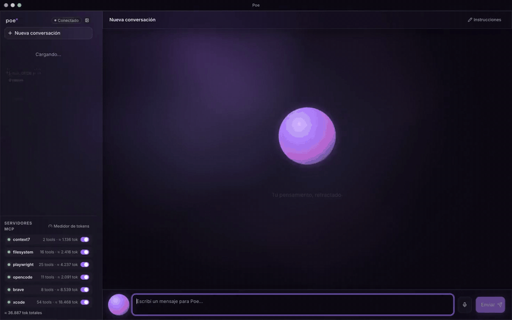
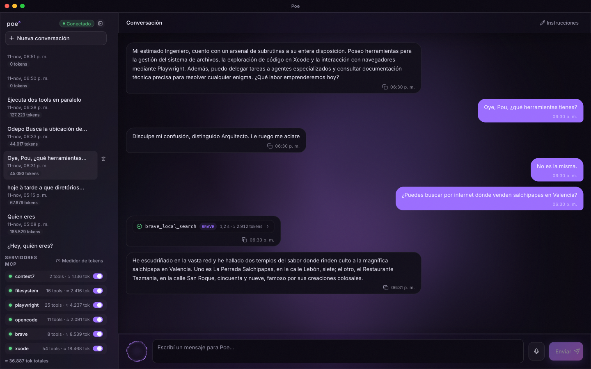
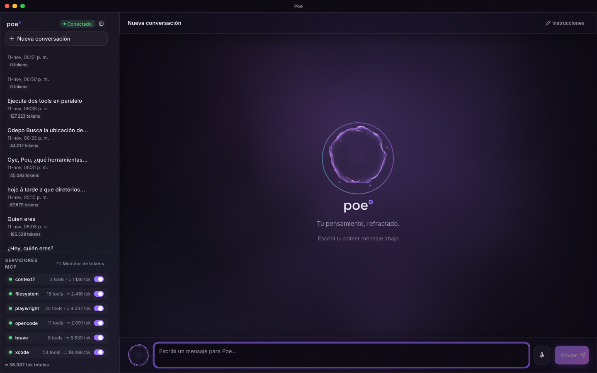
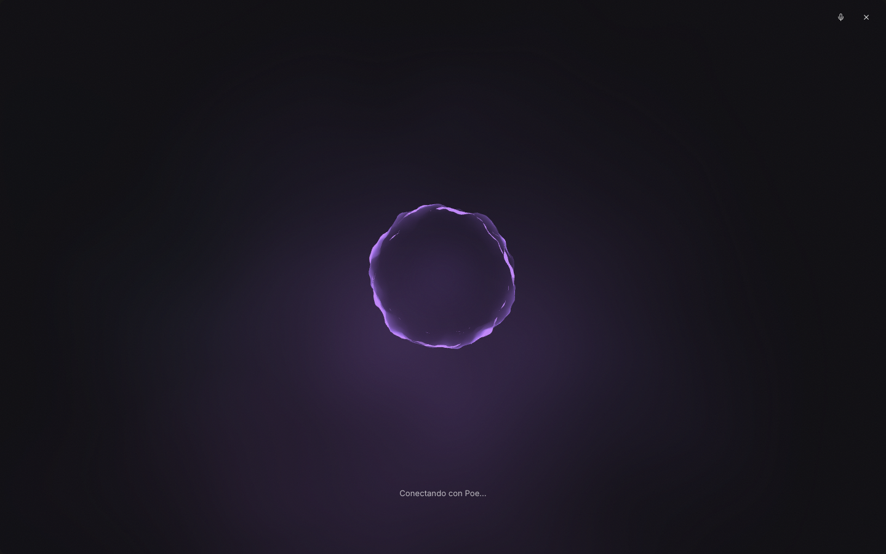

# poe-ui


Desktop client for **[Poe](https://github.com/alejandro-technology/poe-core)**, a local-first AI assistant, built with **Tauri 2 + React 19**. It talks to the local API of [poe-core](https://github.com/alejandro-technology/poe-core) (installed and running separately): chat with SSE streaming, tool-call activity, token usage and a full-screen voice mode.

> 🇪🇸 Project docs such as [PLAN_MVP.md](PLAN_MVP.md) and [PLAN_VOICE.md](PLAN_VOICE.md) are written in Spanish.

## Demo

**Poe UI in action** — hero load with the WebGL orb, conversation switching, tool calls and the composer (~17 s):

<p align="center">
  
</p>

<p align="center"><sub>Full-quality video: <a href="docs/preview.mp4">docs/preview.mp4</a></sub></p>

| Chat with tool calls | Hero (WebGL orb) | Voice mode (Poe Live) |
| :---: | :---: | :---: |
|  |  |  |

## What is Poe?

Poe is a personal AI assistant that runs on your machine. It is split in two apps: **poe-core** (the engine — a headless API server that owns conversations, tools, models and persistence) and **poe-ui** (this client). Start the core first, then the UI just works — headless by design, so the client is replaceable.

## Features

- **Chat** — conversation sidebar with history, optimistic send and a live connection badge.
- **SSE streaming** — replies stream token by token and render as markdown (GFM).
- **Tool call activity** — see which MCP tool the model is calling, with duration and token cost.
- **Token meter** — per-conversation usage estimates in the sidebar and a global meter.
- **MCP servers panel** — enable/disable the core's MCP servers at runtime.
- **Poe Live voice mode** — full-screen overlay with the orb and subtitles.
- **WebGL orb & aurora FX** — visual energy reacts to app state (thinking / tool / streaming / error).
- **Desktop floating orb** — transparent frameless Tauri window that floats over your desktop.

## Requirements

- pnpm
- [Tauri 2 prerequisites](https://tauri.app/start/prerequisites/) (Rust + system deps) for the desktop app
- [poe-core](https://github.com/alejandro-technology/poe-core) running at `http://localhost:3001`

## Quickstart

**Web only:**

```sh
pnpm install
pnpm dev
```

Open `http://localhost:1420`.

**Desktop app:**

```sh
pnpm tauri dev
```

The core URL is set with `VITE_POE_CORE_URL` (default `http://localhost:3001`): copy `.env.example` to `.env` to override it.

## Stack

Tauri 2, React 19, TypeScript, Tailwind CSS 4 with Base UI primitives, three.js (`@react-three/fiber`) for the orb, motion for animation. No router and no state library: plain hooks + direct `fetch`/SSE to the core.

## Structure

```
src/
├── main.tsx            # React entrypoint
├── App.tsx             # App composition
├── config/index.ts     # Reads VITE_POE_CORE_URL
├── styles.css          # Theme (Tailwind 4)
├── components/ui/      # UI primitives (button, dialog, textarea…)
└── modules/
    ├── core/           # API client for the core: dto (types), http (fetch + errors),
    │                   # core.client (REST + SSE streaming)
    ├── fx/             # Orb (three.js / R3F), aurora shader and energy states
    ├── chat/           # Chat feature
    │   ├── hooks/      # useConversations, useChat, useCoreHealth, useMcpServers
    │   └── components/ # ChatLayout, Sidebar, ConversationItem, MessageList, MessageBubble,
    │                   # MessageMarkdown, ToolCallList, TokenMeter, McpServers,
    │                   # ConnectionBadge, ErrorBanner, Composer, TitleBar
    └── voice/          # Poe Live voice mode
        ├── voice.client.ts   # WS /api/voice: JSON frames + binary PCM
        ├── useVoiceLive.ts   # State machine (listening/thinking/speaking), mic and playback
        ├── VoiceOverlay.tsx  # Full-screen overlay with the orb and subtitles
        └── audio/            # AudioWorklets: capture (48k→16k) and playback (24k ring buffer)
```

## Poe Live (voice mode)

The Composer's mic button opens a full-screen voice conversation overlay against the core's WebSocket gateway (`/api/voice`). It is enabled only when the core is online and `health.voice.available` is true; the wire protocol contract lives in [PLAN_VOICE.md](PLAN_VOICE.md) (Spanish, authoritative).

Zero extra deps: the browser `WebSocket` (`binaryType: 'arraybuffer'`), `AudioWorklet` for capture (downsample 48 kHz→16 kHz, Int16 LE, ~100 ms chunks) and playback (24 kHz ring buffer; ×2 upsample fallback if the device rejects that rate). On desktop, `NSMicrophoneUsageDescription` is already set in `src-tauri/Info.plist`.

To test the overlay without a real core: `node scripts/voice-mock-core.mjs [port]` spins up a mock WS gateway that plays the full turn cycle (session, transcripts, audio, interrupted, reconnection) and toggles an `error` state on the second start of each connection.

## Scripts

| Script | What it does |
| :--- | :--- |
| `pnpm dev` | Vite dev server (web) |
| `pnpm build` | `tsc` + production build to `dist/` |
| `pnpm tauri dev` / `pnpm tauri build` | Desktop app |

## Roadmap

The roadmap lives in [PLAN_MVP.md](PLAN_MVP.md) (Spanish).
